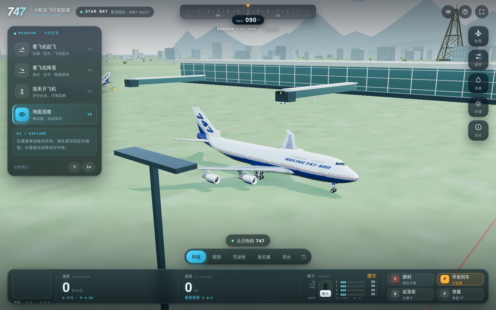
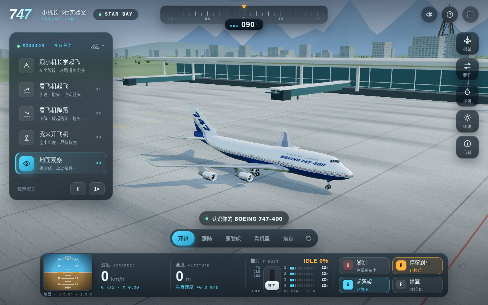
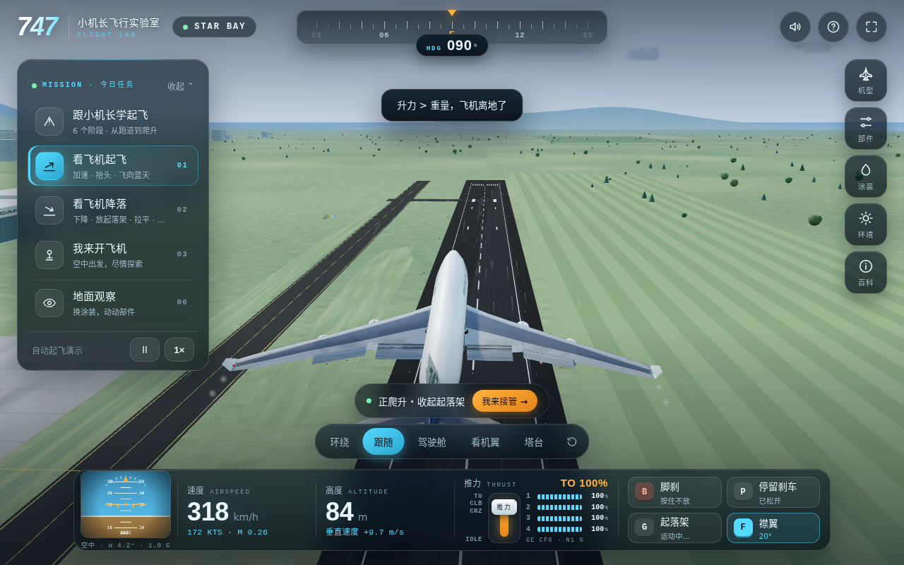
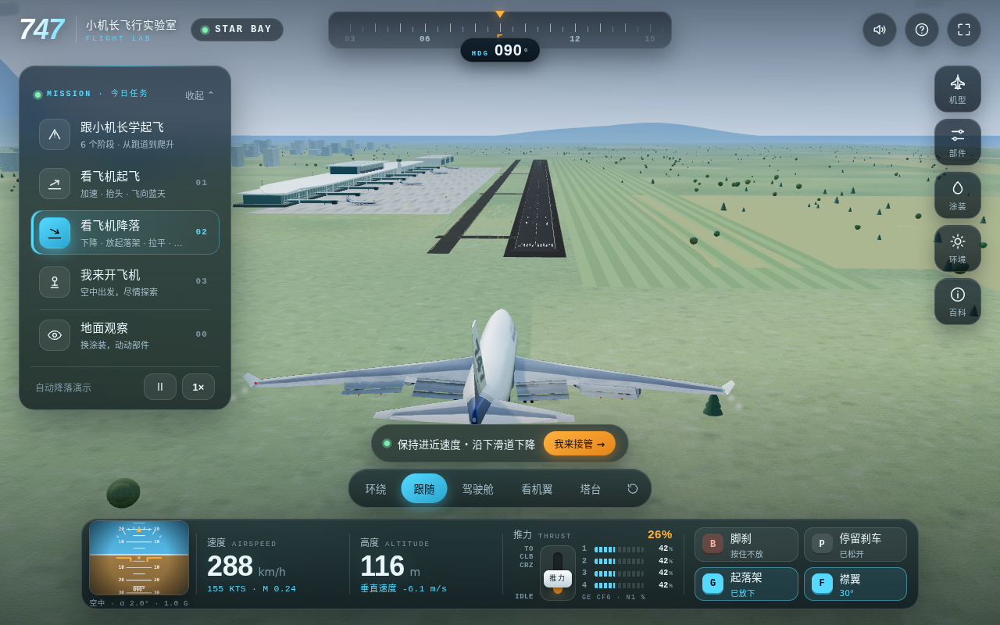
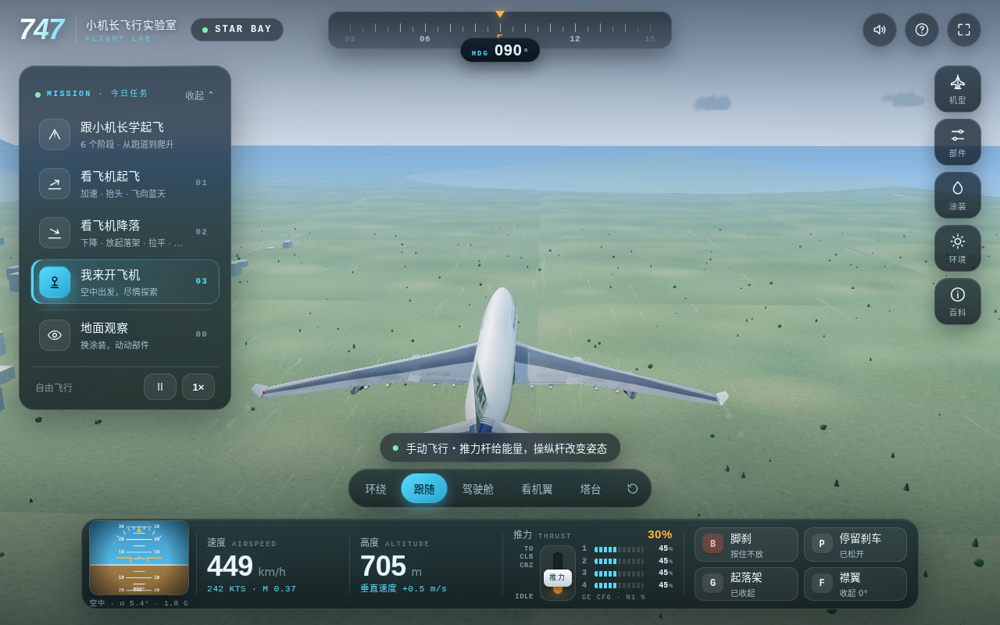
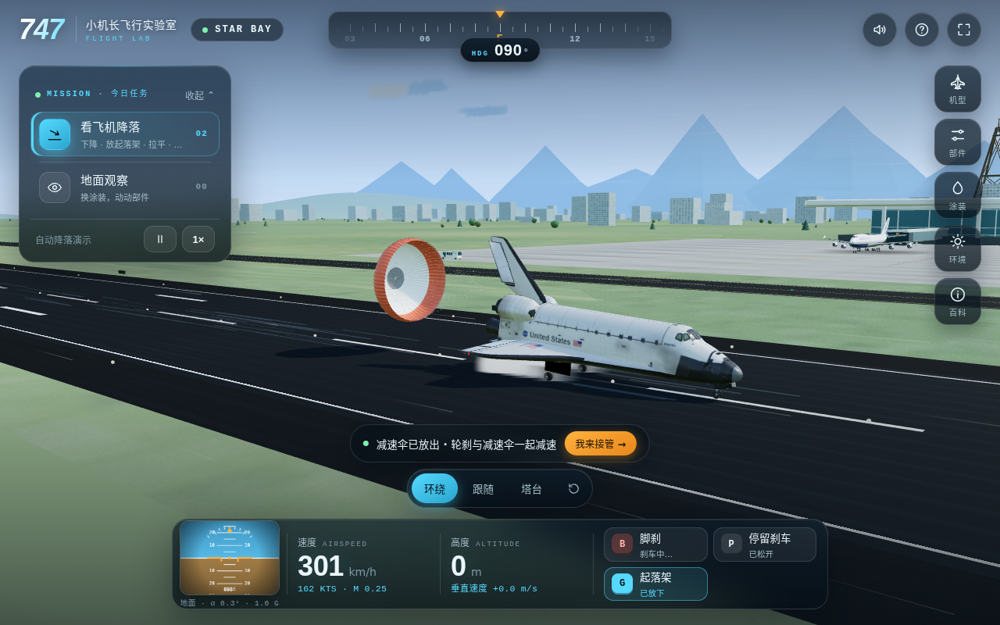

# 747 Flight Lab · Little Captain's Flight Lab

[中文](README.md) · English

An interactive flight-viewing and teaching simulator that runs in the browser. It includes several airliner liveries and the NASA Space Shuttle orbiter, automatic takeoff and landing demos, manual flying, operable parts and several viewpoints. Any desktop or mobile browser with WebGL 2 support can run it.

> **Purpose**: This is a teaching demo for children and beginners. The airport is fictional, and the flight model, instruments, sounds and part animations are simplified. It is not intended for commercial use or flight training.

## Screenshot

### Flight Lab interface



### Modes

| Ground observation | Takeoff |
| --- | --- |
|  |  |
| **Landing** (descending, gear lowering) | **Free flight** (manual flying) |
|  |  |
| **Space Shuttle landing** (drag chute deployed) | |
|  | |

## Features

- **Aircraft**: Boeing 747-400, Airbus A380-800, Airbus A330-300, Boeing 777-200LR / 777F exteriors, and the NASA Space Shuttle orbiter. The orbiter offers landing and ground observation only; takeoff, free flight and the cockpit view are not available.
- **Flight modes**: The left-hand "Today's mission" panel starts automatic takeoff, automatic landing, free flight or ground observation, or switches to manual flying from the runway. The panel can be collapsed and expanded.
- **Automatic landing**: The approach starts at 300 m. The aircraft descends along the glide path, lowers the landing gear below about 260 m (the extension takes about 7 seconds), then flares and touches down.
- **Space Shuttle**: During the rollout after touchdown the orbiter deploys its 40 ft drag chute and jettisons it at about 30 knots. The jettisoned chute falls and lies flat on the runway. When you switch to another aircraft, any remaining chute is removed.
- **Manual controls**: Thrust, brakes, landing gear, flaps, rudder and more. "Manual takeoff from the runway" gives short prompts through the check, takeoff roll, rotation and climb phases. Some aircraft also animate spoilers, thrust reversers, the cargo door and the wipers.
- **Sound**: Turn it on with the sound button. Each aircraft has its own engine sound: the 747-400 and A380 are quad-engine, the A330 and 777 are twin-engine, and the orbiter has no engine noise, only airflow that grows with speed.
- **Views and environment**: Orbit, chase, cockpit, wing and tower views. The airport includes a terminal, runway and taxiway markings, stand guidance lines and ground vehicles such as tugs, fuel trucks, baggage carts and buses. There are also coastline, hills and distant mountains; day, dusk and night; and a choice of detailed or smooth graphics quality.
- **Many liveries**: Airline, manufacturer, commemorative and cargo schemes. The livery list marks each as "real aircraft", "same family" or "no real aircraft" and explains the adaptation. The Air Force One Classic / 2026 schemes are available only on the 747; on the 747-400 they are a same-family visual adaptation, not the actual VC-25A / VC-25B livery.
- **Model preloading**: The browser pre-downloads models while idle, with the A380 files warmed first. Hovering over or focusing an aircraft button also triggers preloading. Data-saver mode and slow 2G / 3G connections skip idle preloading.

## Quick start

### Run locally

You need Node.js 20 or newer and Chrome or Edge with hardware acceleration enabled (WebGL 2 support is required). From the project directory:

```bash
npm ci
npm start
```

Then open <http://localhost:8748/> (the older link <http://localhost:8748/747/> still works). On Windows, run `npm ci` in the project directory once before first use; afterwards you can double-click `启动747模拟器.bat`.

### Docker Compose

You need Docker and Docker Compose:

```bash
docker compose up -d --build
```

Then open <http://127.0.0.1:18748/>. To stop it:

```bash
docker compose down
```

By default Compose binds only to the loopback address. If you access it through a reverse proxy, configure the proxy and access control yourself.

## Controls

| Action | Control |
| --- | --- |
| Pitch | `↑ / W` nose down, `↓ / S` nose up |
| Turn / roll | `← / A`, `→ / D` |
| Rudder | `Q` left, `E` right |
| Thrust up / down | `Shift / Ctrl`, or drag the thrust lever at the bottom |
| Wheel brakes | Hold `B` or the brake button |
| Parking brake | `P` |
| Gear / flaps | `G / F` |
| Thrust reverser | `T` |
| Pause / resume | `Space` |
| Views | `1–5`: orbit, chase, cockpit, wing, tower; `R` resets the view |
| Mouse / touch | Drag to rotate; scroll wheel or pinch to zoom; on-screen buttons support touch flying |

Click the matching mission on the left to start an automatic takeoff or landing. The interface buttons switch playback speed between `1× / 2× / 4×`. Manual takeoff: choose "Let me fly" on the left → open the "Environment" panel and pick "Start from runway" → flaps 20° → press `P` to release the parking brake → add thrust → at about 280 km/h, press `↓` gently to rotate; after liftoff, retract the gear and flaps step by step.

## Model loading and caching

- **A380**: The exterior consists of seven GLB parts that use Meshopt compression, quantized vertices and WebP textures. A first cold load must download and parse all parts, so the time depends on network speed and device performance. Once loaded, a model stays cached for the current page session, so switching back is usually faster. The original files total about 32.5 MiB; about 25 MiB transfers with HTTP gzip.
- **Space Shuttle**: The orbiter skin is now WebP (about 0.31 MB), smaller than the former PNG.
- **Static assets**: Source code, models and textures are checked against the server with ETags. When nothing has changed, the browser uses its local cache (the server replies 304). After a new deployment, the browser loads the new files automatically.

Preloading uses this bandwidth ahead of time; it is not a permanent offline download.

## Development and verification

Common checks:

```bash
npm run check           # flight procedure, controls, lesson course and engine sound profiles
npm run check:liveries  # livery assets
npm run check:camera    # camera controls
npm run check:world     # airport ground-vehicle routes and stops
npm run check:models    # aircraft, animation, lighting and model regression
npm run check:server    # GLB compression, static files and HTTP behaviour
node tests/a380-paint.mjs    # A380 livery loading and status table
node tests/space-shuttle.mjs # Space Shuttle model, drag chute and landing regression
```

Main directories:

- `src/`: simulator, aircraft adaptations, controls, sound (`audio.js`) and the interface.
- `assets/a380/`, `assets/a380-liveries/`: A380 models and two-sided livery textures.
- `assets/aircraft/`, `assets/accurate-a330/`, `assets/accurate-b777/`: other aircraft models and textures.
- `assets/space-shuttle/`: orbiter AC3D model, landing gear, drag chute and textures (FlightGear SpaceShuttle, GPL-2.0), with credit and licence files.
- `tools/`: asset conversion, livery generation and validation tools.
- `tests/`: flight, model, livery, camera, sound and server regression checks.
- `MODEL-NOTES.html`: model sources and dimension verification notes.

## Sources, licences and limitations

Each model and texture may be under a different licence. Before redistributing or using them in another project, read the credit and licence files in the corresponding directory. In particular:

- **A380**: The FlyByWire A380X exterior model is licensed **CC BY-NC 4.0**, for non-commercial use only. See [`assets/a380/CREDITS.txt`](assets/a380/CREDITS.txt) for the source, version and adaptation notes.
- **A330-300**: The upstream resources are GPL-2.0. See [`NOTICE`](assets/accurate-a330/NOTICE) and [`LICENSE`](assets/accurate-a330/LICENSE).
- **777**: See [`LICENSE`](assets/accurate-b777/LICENSE), [`CREDITS`](assets/accurate-b777/CREDITS.txt) and [`AUTHORS`](assets/accurate-b777/AUTHORS).
- **747 and project adaptation code**: The project documents mark the 747 model, livery textures and adaptation code as GNU GPL v2. See [`COPYING`](assets/aircraft/COPYING), [`AUTHORS`](assets/aircraft/AUTHORS) and the [model verification notes](MODEL-NOTES.html).
- **Space Shuttle**: The exterior, textures and landing gear come from the official FlightGear SpaceShuttle aircraft (GPL-2.0). The external model is derived from NASA public-domain work and was adapted under the GPL by Herbert Wagner and others; the high-resolution textures come from the SSU plug-in author Wolf and were modified by Snax with his permission. This repository removes five over-detailed wheel-rim objects and scales the model to NASA's full length. See [`CREDITS`](assets/space-shuttle/CREDITS.txt), [`AUTHORS`](assets/space-shuttle/AUTHORS) and [`LICENSE`](assets/space-shuttle/LICENSE). The NASA logo must not be used to imply NASA endorsement of this project.
- **Three.js**: MIT licence. Airline names, logos and aircraft brands belong to their respective owners. This project does not represent or endorse any airline, manufacturer or model source.

The flight dynamics and automatic landing and takeoff procedures are simplified teaching demonstrations. The A330, A380 and 777 also reuse parts of the 747 flight model or cockpit logic. The model dimensions, livery authenticity, sound and animation completeness are not engineering verification or real flight training.

---
> 本项目由 **CodeX、Claude Code、Pi、Copilot** 使用 **GPT、Claude模型** 生成 · MD 由 **Pi coding agent** 使用 **gpt-6-luna** 生成 · 2026-11-03 16:57 CST

> 由 **Pi Agent** 使用 **gpt-6-luna（github-copilot）** 生成 · 2026-11-15 21:33 CST
