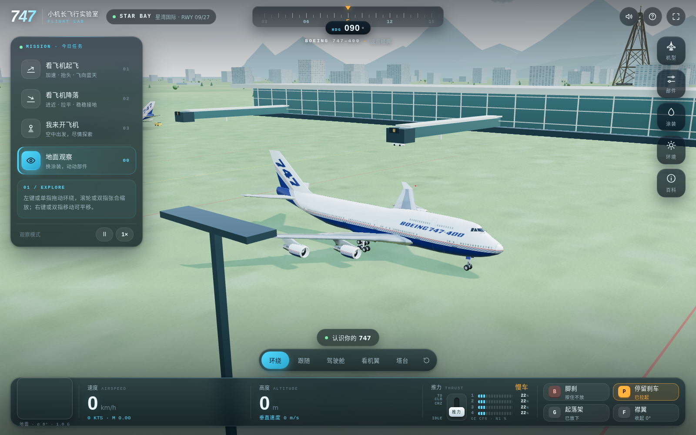

# 747 Flight Lab · 小机长飞行实验室

一个在浏览器中运行的互动式飞行观察与教学模拟器。项目包含多款客机外观、自动起降演示、手动飞行、可操作部件和多种观察视角。使用支持 WebGL 2 的桌面或移动浏览器即可运行。

> **用途说明**：这是儿童与初学者的教学演示，机场为虚构场景；飞行模型、仪表和部件动画均为简化实现，不用于商业。

## 截图

### 飞行实验室界面



## 功能

- **机型**：波音 747-400、空客 A380-800、空客 A330-300、波音 777-200LR / 777F 外观，以及 NASA 航天飞机轨道器（仅提供降落与地面观察，不含起飞、自由飞行与驾驶舱视角；着陆滑跑可放出 40 英尺减速伞）。
- **飞行模式**：左侧任务按钮可进入自动起飞、自动降落、自由飞行或地面观察；也可切换手动驾驶并从跑道开始。
- **手动操作**：推力、刹车、起落架、襟翼、方向舵等控制；“从跑道开始手动起飞”会按检查、滑跑、抬轮和爬升阶段给出简短提示。部分机型还支持扰流板、反推、货舱门和雨刷等部件动画。
- **视角与环境**：环绕、跟随、驾驶舱、机翼、塔台视角；机场包含带玻璃幕墙、曲面顶棚和登机廊桥的航站楼，跑道与滑行道标线、机位引导线、草地绿岛、牵引车、加油车、行李车和摆渡车；地勤车辆会沿机场服务路线行驶，并在停靠点执行循环任务；另有海岸、丘陵和远山；白天、黄昏和夜晚；可切换精细 / 流畅画质。
- **多款涂装**：包含航空公司、制造商、纪念涂装和货运外观。涂装列表会标记“真机”“同系列”或“无真机”，并说明适配情况。空军一号经典版 / 2026 新版仅在 747 机型中可选；在 747-400 上属于同系列视觉适配，不是 VC-25A / VC-25B 真机贴图。
- **模型预加载**：浏览器空闲时预下载模型；A380 文件优先预热。悬停或聚焦机型按钮也会触发预加载。开启省流模式或处于 2G / 3G 等慢速网络时会跳过空闲预加载。

## 快速开始

### 本地运行

需要 Node.js 20 或更新版本，以及启用硬件加速的 Chrome / Edge（需支持 WebGL 2）。在项目目录运行：

```bash
npm ci
npm start
```

然后打开 <http://localhost:8748/>（旧链接 <http://localhost:8748/747/> 仍可用）。Windows 用户首次运行前也需在项目目录执行 `npm ci`；安装完成后可双击 `启动747模拟器.bat`。

### Docker Compose

需要已安装 Docker 和 Docker Compose：

```bash
docker compose up -d --build
```

打开 <http://127.0.0.1:18748/>。结束运行：

```bash
docker compose down
```

Compose 默认只绑定本机回环地址；如需通过反向代理访问，请自行配置代理与访问控制。

## 操作

| 操作 | 控制 |
| --- | --- |
| 俯仰 | `↑ / W` 低头，`↓ / S` 抬头 |
| 转弯 / 横滚 | `← / A`、`→ / D` |
| 方向舵 | `Q` 左舵，`E` 右舵 |
| 增加 / 减少推力 | `Shift / Ctrl`，也可拖动底部推力杆 |
| 轮刹 | 按住 `B` 或按住脚刹按钮 |
| 停留刹车 | `P` |
| 起落架 / 襟翼 | `G / F` |
| 反推 | `T` |
| 暂停 / 继续 | `Space` |
| 观察视角 | `1–5`：环绕、跟随、驾驶舱、机翼、塔台；`R` 重置视角 |
| 鼠标 / 触屏 | 拖动旋转视角，滚轮或触控缩放；屏幕按钮可用于触控飞行 |

自动起飞 / 降落可点击左侧对应任务开始，界面按钮可切换 `1× / 2× / 4×` 播放速度。手动起飞流程：左侧选择“我来开飞机” → 打开“环境”面板并选“从跑道开始” → 襟翼 20° → 按 `P` 松开停留刹车 → 增加推力 → 约 280 km/h 时轻按 `↓` 抬头；离地后收起落架并逐步收襟翼。

## 模型载入与缓存

A380 外观由 7 个 GLB 部件组成，文件内使用 Meshopt、顶点量化和 WebP 贴图。首次冷载入需要下载并解析全部部件，耗时会受网络速度、浏览器和设备性能影响；模型成功载入后会缓存在当前页面会话中，之后切换通常更快。A380 资源约 32.5 MiB（原始文件），HTTP gzip 传输约 25 MiB；预加载会提前消耗这部分流量，并非永久离线下载。

## 开发与验证

常用检查命令：

```bash
npm run check           # 飞行流程与控制
npm run check:liveries   # 涂装资源
npm run check:camera     # 相机控制
npm run check:world      # 机场地勤车辆路线与停靠
npm run check:models     # 机型、动画、照明与模型回归
npm run check:server     # GLB 压缩、静态文件和 HTTP 行为
node tests/a380-paint.mjs # A380 涂装加载与状态表
```

主要目录：

- `src/`：模拟器、机型适配、控制与界面。
- `assets/a380/`、`assets/a380-liveries/`：A380 模型和双侧涂装贴图。
- `assets/aircraft/`、`assets/accurate-a330/`、`assets/accurate-b777/`：其他机型模型与纹理。
- `assets/space-shuttle/`：航天飞机轨道器 AC3D 模型、起落架、减速伞与贴图（FlightGear SpaceShuttle，GPL-2.0），以及署名与许可文件。
- `tools/`：资源转换、涂装生成和校验工具。
- `tests/`：飞行、模型、涂装、相机和服务器回归检查。
- `MODEL-NOTES.html`：模型来源与尺寸校核记录。

## 来源、许可与限制

模型与纹理各自适用的许可可能不同；再分发或用于其他项目之前，请先阅读对应目录中的署名与许可文件。特别注意：

- **A380**：FlyByWire A380X 外观模型采用 **CC BY-NC 4.0**，仅限非商业用途；来源、版本和改编说明见 [`assets/a380/CREDITS.txt`](assets/a380/CREDITS.txt)。
- **A330-300**：上游资源为 GPL-2.0；见 [`NOTICE`](assets/accurate-a330/NOTICE) 和 [`LICENSE`](assets/accurate-a330/LICENSE)。
- **777**：请查阅 [`LICENSE`](assets/accurate-b777/LICENSE)、[`CREDITS`](assets/accurate-b777/CREDITS.txt) 和 [`AUTHORS`](assets/accurate-b777/AUTHORS)。
- **747 与项目适配代码**：项目说明将 747 模型、涂装贴图和适配代码标为 GNU GPL v2；见 [`COPYING`](assets/aircraft/COPYING)、[`AUTHORS`](assets/aircraft/AUTHORS) 和 [`模型校核记录`](MODEL-NOTES.html)。
- **航天飞机**：外形、贴图与起落架来自 FlightGear 官方 SpaceShuttle 机型（GPL-2.0；外部模型源自 NASA 公有领域，经 Herbert Wagner 等在 GPL 下改编，高清贴图来自 SSU 插件作者 Wolf，经其同意后由 Snax 修改）。本仓库剔除了 5 个过度细分的轮辋对象并按 NASA 全长缩放，详见 [`CREDITS`](assets/space-shuttle/CREDITS.txt)、[`AUTHORS`](assets/space-shuttle/AUTHORS) 与 [`LICENSE`](assets/space-shuttle/LICENSE)。NASA 徽标不得用于暗示 NASA 认可本项目。
- **Three.js**：MIT 许可。航空公司名称、标志及飞机品牌属于各自权利人；本项目不代表或背书任何航空公司、制造商或模型来源。

本项目中的飞行力学和自动起降流程为简化教学演示；A330、A380 和 777 也复用部分 747 飞行模型或座舱逻辑。模型尺寸、涂装真实性和动画完整性不等同于工程校核或真实飞行训练。

---
> 本项目由 **CodeX、Claude Code、Pi、Copilot** 使用 **GPT、Claude模型** 生成 · MD 由 **Pi coding agent** 使用 **gpt-6-luna** 生成 · 2026-11-03 16:57 CST

> 由 **Pi Agent** 使用 **claude-haiku-5.5（github-copilot）** 生成 · 2026-11-13 21 CST
